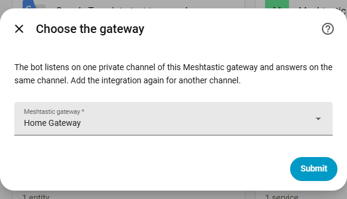
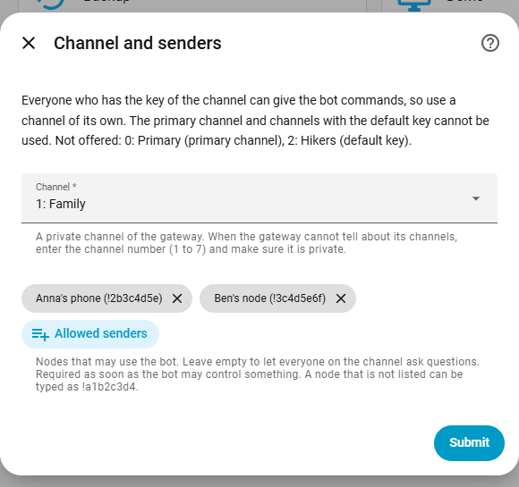
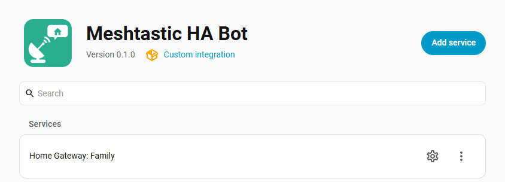
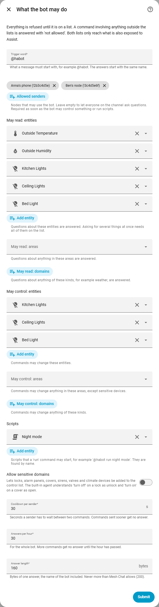
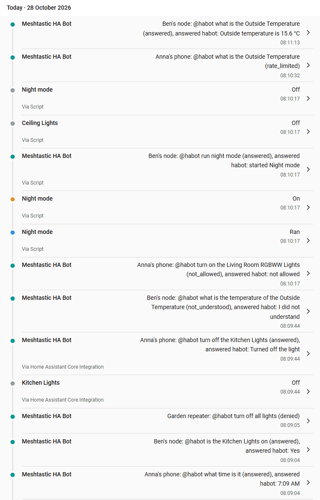

<p align="center"></p>

# Meshtastic HA Bot (`@habot`)

A Home Assistant integration that lets the people on a **private Meshtastic channel** talk to **Home Assistant's
Assist**. Someone sends `@habot is the kitchen light on` on the channel, the bot asks Home Assistant's built-in
conversation agent, and the answer goes back to the same channel over the mesh, with no internet needed.

```
Anna   @habot what time is it
habot  habot: 7:09 AM
Ben    @habot turn off the Kitchen Lights
habot  habot: Turned off the light
Anna   @habot turn on the Living Room RGBWW Lights
habot  habot: not allowed          (that light is not on the control list)
```

It works through the [Meshtastic integration](https://github.com/meshtastic/home-assistant) (messages in and out) and
Home Assistant's [conversation](https://www.home-assistant.io/integrations/conversation/) integration (the brain).

> ## ⚠️ Every member of the channel can give commands
>
> Anyone who has the key of the channel can send `@habot ...` and, unless you restrict it, use everything the bot is
> allowed to do. The channel key is the real lock: use a channel of its own, only invite people you trust with
> what you allow here, and rotate the key when someone should no longer have access. Read [Security](#security).

## Contents

1. [What it does](#what-it-does)
2. [Requirements](#requirements)
3. [Installation](#installation)
4. [Setup](#setup)
5. [What the bot may read and do](#what-the-bot-may-read-and-do)
6. [Security](#security)
7. [Replies](#replies)
8. [Options](#options)
9. [Audit](#audit)
10. [Telegram and other bridges](#telegram-and-other-bridges)
11. [Troubleshooting](#troubleshooting)
12. [Limits and risks](#limits-and-risks)

## What it does

- Listens on **one private channel** per bot (add the integration again for another channel). Direct messages are
  never read.
- Reacts only to messages that **start with the trigger word** (default `@habot`, case-insensitive, followed by a
  space) and come from a node on the **allowed senders** list (required as soon as the bot may control anything, see
  [Security](#security)). Everything else on the channel is ignored.
- Hands the rest of the message to Home Assistant's built-in conversation agent and sends the answer back as a channel
  message, shown in Mesh Chat as sent by the bot.
- Can run **scripts you chose**, as commands: `@habot run night mode`.

What the agent understands is Home Assistant's own set of sentences for the entities that are exposed to Assist, in
the language Home Assistant is set to, for example *turn on the living room light*, *turn off all lights*,
*which lights are on*, *is the front door locked*, *what is the temperature in the living room*, *what time is it*.
A sentence has to name the device, the area or the kind of device (*turn on the light* is not enough). Sentences that
you added yourself (automations with a sentence trigger, custom sentences) are not available through the bot, and
neither is a follow-up such as *and upstairs?*.

## Requirements

- Home Assistant 2026.2 or newer.
- The Meshtastic integration with a gateway node, and its `send_text` action.
- Home Assistant's built-in conversation agent (always present).
- **No API key, no account and no cloud service.** The bot only uses the local, built-in agent. Other conversation
  agents (LLMs) are not supported: the lists below can only be enforced for the built-in agent.

## Installation

Through [HACS](https://hacs.xyz) as a custom repository:

[](https://my.home-assistant.io/redirect/hacs_repository/?owner=rdkmedia0&repository=meshtastic-habot&category=integration)

1. In HACS choose *Custom repositories*, add `https://github.com/rdkmedia0/meshtastic-habot` as type *Integration* (or
   use the button above).
2. Download **Meshtastic HA Bot** and restart Home Assistant.

Or copy the `custom_components/meshtastic_habot` folder into the `custom_components` folder of your Home Assistant
configuration and restart.

## Setup

1. *Settings → Devices & services → Add integration → Meshtastic HA Bot*.
2. Choose the **gateway** (your Meshtastic integration entry).

   <p align="center"></p>

3. Choose the **channel** and the **allowed senders**. Only private channels are offered; the primary channel and channels
   with a default key are listed as not available. When the Meshtastic integration cannot tell about the channels of the
   gateway, enter the channel number instead and make sure the channel is private (the bot checks it as soon as the
   gateway reports its channels). If the channel has MQTT uplink on you are asked to confirm.

   The allowed senders are chosen from the nodes your gateway knows (a node that is not listed can be typed, as
   `!a1b2c3d4`). Nodes are recognised by their **node id**, not by their name, see [Troubleshooting](#troubleshooting).

   <p align="center"></p>

4. Open *Configure* on the bot (the cogwheel) to add what it may read, what it may control and which scripts it may run
   (all of it is empty to begin with).

   <p align="center"></p>

5. Test it read-only first, from a node on the allowed list that is **not the gateway itself**:
   `@habot what time is it`. That question needs no list entry, so it works before you configure anything else.

## What the bot may read and do

Home Assistant's own *Expose* list (Settings → Voice assistants) is global for everyone who uses Assist and cannot be set
per channel, so the bot has **its own two lists on top of it**. Both are **empty by default**; nothing is allowed until you
add it. The bot can only ever touch what is **on its list and exposed to Assist**.

<p align="center"></p>

| List | What goes in it | Examples |
|---|---|---|
| **May read** | entities, areas and domains the bot may answer questions about | the temperature sensor, the weather, the area *Garden* |
| **May control** | entities, areas and domains the bot may change | the living room light, the area *Garden*, the domain `light` |
| **Scripts** | scripts the bot may run | `script.night_mode` as `@habot run night mode` |

- A command or question that involves anything outside the lists is refused with *not allowed*. Nothing runs, and a
  question is not answered. *Involves* means every entity the sentence can mean: *which lights are on* needs every light
  on the read list (the ones that are off are part of the answer), *turn off all lights* needs every light on the
  control list.
- *What time is it* and *what is the date* involve no entity at all, so they are answered without a list. They are
  also the easiest way to test that the bot works.
- Scripts are the safest way to give control: a script does exactly what you wrote. Write them so that running one twice
  is harmless (set a state, do not toggle). A script is found by its name or by the part of its entity id after `script.` (`@habot run night mode` and
  `@habot run night_mode` are the same) and has to be on the scripts list; a script that exists but is not on it is
  refused exactly like one that does not exist. The answer *started Night Mode* means the script was started.
- **Sensitive domains** (`lock`, `alarm_control_panel`, `cover`, `siren`, `valve`, `climate`) can only be controlled when you
  switch on **Allow sensitive domains** in the options *and* name the entity or the domain on the control list. An area on
  the control list never covers them. Note that the built-in agent understands *turn off* on a lock as *unlock* and
  *turn on* on a cover as *open*, and that the setup refuses a sensitive domain on the control list while the option is
  off.
- Reading is not harmless: *is anyone home*, *is the front door locked* and device trackers tell a stranger when the house
  is empty. Keep presence and security entities off the read list unless every member of the channel should know.

How the lists are enforced: the bot lets Home Assistant recognise the sentence (exact wording, exposed entities only), and
before anything runs it looks up which entities the sentence is about, the way Home Assistant's own intent handlers do,
and checks every one of them. A **command** is checked before it runs, a **question** changes nothing, so the agent
answers first and the entities it really answered with are checked before the answer is sent. If nothing can be found
that the sentence is about, the command is refused (it fails closed).

## Security

| Control | Behaviour |
|---|---|
| **Where it runs** | Only on a **private channel**: not the primary channel, not a channel with the default (public) key, never direct messages. The setup only offers such channels and the bot checks again every time it starts. |
| **What it may do** | The two lists and the scripts above, empty by default. |
| **Who may use it** | An optional list of allowed **sender nodes**. Required as soon as the control list or the scripts list is not empty (without it the bot does not start). Messages from anyone else are ignored without an answer. |
| **Abuse limits** | A cooldown per sender (default 30 s), a cap on answers per hour for the whole bot (default 30), a maximum length for a command (120 characters), at most three commands waiting for the one being answered, and a lock-out of 15 minutes after five refused commands within ten minutes. Limited messages are dropped without an answer, so the bot cannot be used to fill the channel. |
| **Loops** | Messages from the gateway itself are never treated as commands, and neither are answers of other bots: an answer starts with the name of the bot (`habot: ...`), which is not the trigger word (`@habot` followed by a space). A packet the gateway reports twice is answered once. |
| **Audit** | Every command is written to the logbook and fired as an event. See [Audit](#audit). |
| **Privacy of answers** | An answer goes over the air to everyone who has the channel key. The setup asks for a confirmation when the channel has **MQTT uplink** on, because then an answer such as the temperature of a room can leave your house over the internet. |

**What "allowed sender" means.** On a channel the sender of a message is not authenticated: anyone who has the channel key
can send a packet that claims to come from an allowed node. The sender list keeps out accidents and people who are on
the channel but not on your list; it does not stop someone who deliberately fakes a node. Someone who holds the channel
key is trusted with whatever the lists allow, which is why the channel is private, the lists are small and the key is
rotated when somebody should no longer be on the channel. There is no stronger check in this version.

## Replies

Mesh delivery is best effort, so **a missing reply never means that something failed**, and not a success either.

| Situation | Reply |
|---|---|
| Allowed sender, command done | Yes, with the result, for example `habot: Turned on the light` |
| Allowed sender, command not allowed | Yes, `habot: not allowed` |
| Allowed sender, sentence not understood | Yes, `habot: I did not understand` |
| Allowed sender, something went wrong | Yes, `habot: that did not work` (or Home Assistant's own message) |
| Sender not on the list, rate limit hit, locked out, command too long | None. The audit has it, the channel does not get noise |

- **No reply: check before you repeat.** Ask `@habot is the living room light on`, or look at Mesh Chat and the logbook in
  Home Assistant, which show what really happened. See also [Troubleshooting](#troubleshooting).
- Commands set a state (*on*, *off*, *set to 20 degrees*), so repeating one is harmless. Scripts you allow should behave
  the same way.

**Short answers.** A Meshtastic text message holds about **200 bytes** (the limit Mesh Chat enforces) and airtime is shared
with everyone on the mesh, so every answer is one short message: markdown, emoji and line breaks are removed, the length
is counted in **bytes**, the name of the bot is part of the budget, and an answer that is still too long is cut at the end
of a word and finished with `…`. It is never split over several messages.

## Options

| Option | Default | Notes |
|---|---|---|
| Trigger word | `@habot` | What a message must start with. 2 to 20 characters, no spaces. The bot answers under the same name without the `@`. |
| Allowed senders | none | Nodes that may use the bot. Required for control and scripts. |
| May read: entities, areas, domains | nothing | |
| May control: entities, areas, domains | nothing | |
| Scripts | none | Scripts that `@habot run <name>` may start. |
| Allow sensitive domains | off | Lets locks, alarm panels, covers, sirens, valves and climate be added to the control list. |
| Cooldown per sender | 30 s | |
| Answers per hour | 30 | For the whole bot. |
| Answer length | 160 bytes | Never above the Mesh Chat limit (200), name of the bot included. |

Saving the options restarts the bot, which also forgets the cooldowns and lock-outs.

## Audit

Every command is fired as the event `meshtastic_habot_command`, which the **logbook** (*Activity*) shows, with the sender
as the name of its device in Home Assistant:

<p align="center"></p>

| Field | |
|---|---|
| `sender`, `sender_name` | node number and name of the sender (`!a1b2c3d4` when the node is not a device in Home Assistant) |
| `text` | the message as it was received |
| `decision` | `answered`, `denied` (sender not allowed, or command too long), `not_allowed` (outside the lists), `not_understood`, `rate_limited`, `locked_out`, `error` |
| `answer` | the message that was sent back; empty when the bot stayed silent |
| `channel`, `config_entry_id` | where it happened |

Automations can use the event, for example to notify you when a command is denied or not allowed.

## Telegram and other bridges

Only **Meshtastic nodes on the allowed list** can give commands. A message that a bridge such as the
[Meshtastic Telegram bridge](https://github.com/rdkmedia0/meshtastic-telegram-bridge) copies into the channel is sent
by the **gateway node**, and the bot never treats messages from the gateway as commands. So someone who writes
`@habot ...` in Telegram gets no answer, and cannot make the bot do anything.

If a bridge also copies the **channel to Telegram**, the answers of the bot appear there too, for everyone in that chat.
Keep the bot's channel out of such a bridge, or keep sensitive entities off the read list.

## Troubleshooting

The bot stays **silent** for senders that are not allowed, so most problems look like "no reply". Open the **logbook**
and look for *Meshtastic HA Bot*:

| What you see | Meaning |
|---|---|
| No entry at all | The bot did not see the message. Check that it was sent on the configured channel, starts with the trigger word and a space, is not a direct message, and was not sent **by the gateway node itself** (for example from Mesh Chat in Home Assistant, which sends as the gateway). Check that the bot shows no error under *Settings → Devices & services*. |
| `denied` | The sender is not on the allowed list (or the command is longer than 120 characters). |
| `rate_limited`, `locked_out` | The cooldown, the hourly cap or the lock-out dropped the command. |
| `not_understood` | Home Assistant did not understand the sentence. Use the exact name of the device, in the language Home Assistant is set to, and make sure the entity is exposed to Assist. |
| `not_allowed` | The sentence involves something that is not on the lists. |
| `answered`, but nothing arrived | The reply was sent but not delivered, or sending failed (see the Home Assistant log for `Failed to send an answer`). |

**A node that stops working after an update.** The bot recognises a sender by its node id (`!a1b2c3d4`), never by its
name. A device can get a new id, for example after a reset, a reflash or new hardware, and the gateway then lists two
nodes with the same name: the old one, which stays in the list for a while, and the new one. Open *Configure* on the bot,
add the id of the node that is sending now (it is shown on the node in Mesh Chat) and remove the old one.

## Limits and risks

- Everyone who holds the channel key can use what the lists allow, and the sender list can be faked by them.
- Answers use airtime and reach everyone on the channel.
- Mesh delivery is best effort: a question or an answer can be lost.
- Understanding of the sentence is Home Assistant's: the built-in agent can match the wrong entity when names are
  similar. The lists limit the damage; they do not make the matching perfect.
- A question is answered by Home Assistant before the bot checks what it was about, so a refused question still
  runs (it changes nothing); only the answer is held back.

## License

[MIT](LICENSE)
